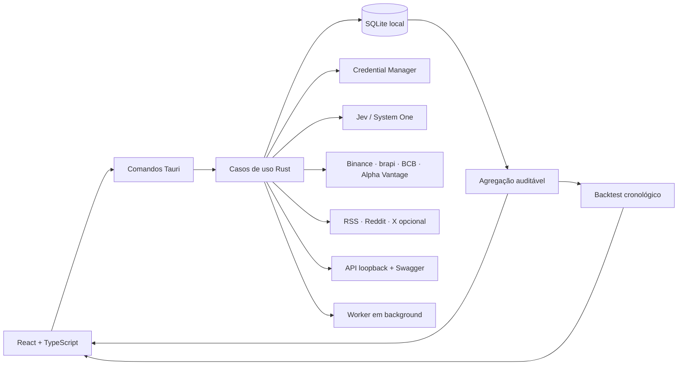

# JevRadar

Radar desktop local-first de sentimento, contexto e sinais de mercado. O JevRadar cruza conteúdo público, classificações tipadas do Jev e séries reais de mercado para mostrar mudanças de atenção e medir o que ocorreu historicamente depois de sinais semelhantes.

> O JevRadar não recomenda compra ou venda, não define tamanho de posição, não executa ordens e não substitui análise profissional.

## Estado do projeto

O repositório está em **alpha para Windows**. O núcleo público funciona sem qualquer motor preditivo privado e inclui:

- wizard inicial bilíngue, preferências locais e credenciais no Windows Credential Manager;
- watchlist de até 50 ativos;
- preços de Binance e brapi, indicadores do Banco Central, ações/ETFs dos EUA via Alpha Vantage BYOK e conteúdo via RSS, Reddit oficial (posts e comentários de comunidades BR/globais) e X opcional BYOK;
- fontes personalizadas tipadas como publicação ou fórum público, coletadas por RSS/Atom HTTPS com deduplicação;
- lista configurável de até 25 comunidades do Reddit, com coleta oficial de posts e comentários;
- classificação Jev por ativo, sentimento, relevância, tipo, alegação factual, hype e contexto externo;
- validação estrita do contrato Jev, consumo diário de tokens visível na central operacional e tratamento explícito de autenticação, limite de uso e sobrecarga;
- agregação auditável, alertas locais em quatro níveis e coleta em background configurável;
- teste explícito de notificação nas configurações, sem criar sinal ou alterar o histórico;
- dashboard com filtros na URL, mapa de calor, preço × sentimento, eventos, contexto educacional e lacunas de cobertura;
- central de sinais com filtros na URL, comparação de intensidade, confiança, diversidade e acesso aos relatórios auditáveis;
- feed paginado de evidências com filtros por origem, tipo, sentimento, estado e confiança;
- explorador paginado de eventos políticos, econômicos e geopolíticos, com relações rastreáveis por ativo, país, tipo e confiança;
- mapa agregado de relações entre países e ativos, com separação explícita entre relação conhecida, correlação, hipótese e causalidade não comprovada;
- central macro e geopolítica com KPIs, ranking de contextos, países/regiões e ativos relacionados, acompanhada por alternativa tabular acessível;
- comparação compartilhável de 2–4 ativos da watchlist, com preço, sentimento, confiança, diversidade, hype e eventos em escalas separadas;
- central de lacunas de cobertura que cruza movimentos reais de preço com volume editorial, sem transformar ausência de discussão em recomendação;
- backtest cronológico em 1, 7 e 30 dias, com baseline, intervalo de confiança e separação calibração/avaliação;
- central de padrões históricos que compara somente backtests do mesmo contrato, limiares e versões, com filtro de amostra e desempenho contra baseline;
- central de prontidão que expõe dias observados, entradas reais, backtests e amostras por horizonte antes de liberar interpretações comparáveis;
- exportação de relatório de mercado em Markdown e JSON versionado, com sinais, fatos, relações e backtests do mesmo recorte auditável;
- API local opcional, autenticada e somente leitura, com Swagger, evidências auditáveis e prontidão de calibração em `http://127.0.0.1:47831/docs/`;
- atualização confirmada pelo usuário em builds assinados, com verificação criptográfica do artefato;
- exportação do SQLite e exclusão confirmada do histórico local.

Scraping HTML de fóruns e outras fontes internacionais são adapters futuros, não funcionalidades simuladas. Hoje, fóruns que exponham RSS/Atom público podem ser cadastrados e auditados como fóruns, sem se confundirem com fontes editoriais. A integração Alpha Vantage usa a chave do usuário, catálogo oficial de ações/ETFs ativos e histórico diário; a coleta rotaciona no máximo cinco ativos americanos por execução e não apresenta dados gratuitos como tempo real. Novos scrapers exigem revisão individual de termos e `robots.txt`. Fontes pagas são sempre opcionais e usam credenciais do próprio usuário.

## Arquitetura



O frontend separa `types`, `services`, `hooks`, `components` e `pages`. O core separa domínio, aplicação, infraestrutura e interface. Tokens visuais ficam em `src/styles/tokens.css`; nenhuma credencial é gravada no frontend ou no SQLite.

Decisões e especificação:

- [SDD](.docs/specs/jev-radar-sdd.md)
- [ADR 0001 — open core local](.docs/adr/0001-open-core-local.md)
- [regras de engenharia](.rules/JEVRADAR-ENGINEERING.md)

## Requisitos

- Windows 10/11;
- Node.js 22 ou superior;
- Rust stable com toolchain MSVC;
- WebView2;
- chave TypeSafe/Jev para classificação. As fontes gratuitas continuam utilizáveis sem ela.

## Desenvolvimento

```powershell
npm ci
Copy-Item .env.example .env
npm run dev
```

O `.env` serve apenas ao desenvolvimento e é ignorado pelo Git. As credenciais usadas pelo aplicativo devem ser cadastradas no wizard ou em Configurações.

Comandos principais:

```powershell
npm run ops
npm run check
npm run check:rust
npm run build:web
npm run build
npm run test:e2e:desktop
npm run release:smoke
npm run release:signed
```

`npm run ops` oferece um menu para desenvolvimento, testes, E2E e builds. O E2E usa o
executável compilado e o WebView2 real; rode `npm run build` antes dele. O build desktop
gera o instalador NSIS para Windows.

`release:signed` é o caminho de publicação: exige certificado Authenticode, chave do
updater, endpoint HTTPS e servidor de timestamp. A ausência de qualquer pré-requisito
interrompe o processo antes de publicar um artefato que pareça assinado.

## Segurança e dados

- API local desligada por padrão, limitada a `127.0.0.1` e protegida por bearer token;
- nenhuma telemetria externa é enviada nesta release;
- segredos armazenados pelo keychain do sistema;
- teto diário e por lote para consumo do Jev;
- contagem local de tokens de entrada e saída por análise, sem registrar a chave ou enviar telemetria externa;
- conteúdo social bruto é anonimizado ao vencer a retenção, sem destruir a trilha agregada de auditoria;
- exportação cria uma cópia consistente na pasta Downloads;
- exclusão de histórico preserva preferências, catálogo e credenciais.

Falhas de segurança devem seguir [SECURITY.md](SECURITY.md).

## Open core

Este repositório Apache-2.0 contém o aplicativo completo descritivo, integrações e contratos públicos. Um eventual motor preditivo avançado terá repositório e licença próprios; sua ausência não desabilita os recursos públicos descritos acima.

## Contribuição

Leia [CONTRIBUTING.md](CONTRIBUTING.md). Commits seguem Conventional Commits em pt-BR e representam entregas lógicas completas — sem misturar demandas independentes.

## Licença

Apache License 2.0. Consulte [LICENSE](LICENSE).
